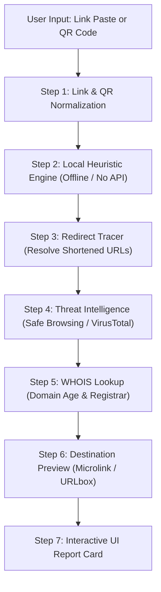

# ScamLens — Link & QR Scam Scanner
## Comprehensive Project Report & Technical Specification

---

### Executive Summary
**ScamLens** is a dual-layer cybersecurity verification tool designed for everyday users. It evaluates untrusted web addresses and QR codes through an immediate, self-contained **Local Heuristic Engine** (built entirely without external third-party APIs), followed by simulated/online **Threat Intelligence APIs**, **WHOIS Domain Age Lookups**, and **Destination Previews**. The final output is rendered in an accessible, jargon-free **Interactive UI Report Card**.

---

## 1. Problem Statement
Scam links and fraudulent QR codes represent the predominant attack vectors for credential harvesting, financial fraud, and malware distribution:
1. **URL Obfuscation & Evasion**: Cybercriminals disguise malicious destinations using URL shorteners, multi-hop open redirects, deceptive subdomains, and look-alike domains (typosquatting).
2. **The "Blind QR Code" Vulnerability**: QR codes conceal the destination URL until scanned and opened. With the proliferation of QR codes on parking meters, restaurant tables, flyers, and payment terminals ("quishing"), victims have no visual mechanism to assess destination legitimacy beforehand.
3. **Information Asymmetry**: Mainstream security tools rely on heavy technical terminology ("SSL/TLS mismatch", "Autonomous System Numbers", "DNS CNAME recursion") that alienates non-technical users, preventing them from making informed security decisions.

There is a critical need for a lightweight, mobile-first utility that users can invoke directly from their messaging and browsing workflows to receive an instant, plain-English security verdict.

---

## 2. Objective
To build a client-side Scam Link and QR Scanner that:
- Ingests URLs via manual paste, mock QR code image capture, or intent sharing.
- Performs an instantaneous, offline, zero-network security evaluation through a **self-implemented 9-point heuristic detection engine**.
- Executes a multi-stage threat pipeline (Redirect Tracing, Threat DB check, WHOIS domain age lookup, and Destination Previews).
- Synthesizes findings into a clear, WCAG AA-compliant **Report Card** presenting a risk score (0–100), risk level (Low, Medium, High), and plain-English actionable advice.

---

## 3. Proposed Solution & Processing Pipeline

The architecture is built around an optimized sequential pipeline where computationally lightweight, offline heuristic checks execute first. External checks only proceed if needed, minimizing latency and eliminating unnecessary network traffic:



### Pipeline Stage Details

| Step | Component | Description | Latency | Dependency |
|:---:|:---|:---|:---:|:---:|
| **1** | **Link Input & QR Reader** | Normalizes URL string, extracts QR payload from camera/photo | < 10ms | Native / Local |
| **2** | **Local Heuristic Engine** | Runs 9 rule sets (keywords, TLDs, IP literals, Levenshtein typosquatting, `@` spoofing, etc.) | < 5ms | **Self-Implemented (No API)** |
| **3** | **Redirect Tracer** | Inspects HTTP headers (301/302) to unmask shortened/redirected URLs (`bit.ly`, `tinyurl`) | 150–400ms | HTTP Client |
| **4** | **Threat Intelligence** | Queries Google Safe Browsing and VirusTotal hash/domain blocklists | 200–500ms | Threat API |
| **5** | **WHOIS Registration** | Extracts domain registration timestamp, registrar name, and age | 300–600ms | WHOIS API |
| **6** | **Destination Preview** | Fetches site metadata, OpenGraph cards, and rendered screenshot thumbnail | 400–800ms | Metadata / Screenshot API |
| **7** | **Report Card UI** | Consolidates risk score, categorical flags, and plain-English verdict | Instant | UI Presentation |

---

## 4. Key Features & Implementation Matrix

| Feature | Technical Implementation | Category | Dependency |
|:---|:---|:---:|:---:|
| **Manual Paste & Clear Input** | Mobile-optimized HTML5 input with auto-clean and touch targets | Entry Point | **No API** |
| **QR Code Scanner** | Mock image upload / simulated on-device camera extraction | Entry Point | **No API** |
| **Local Heuristic Scam Engine** | 9-parameter heuristic analysis + Levenshtein distance algorithm | Core Engine | **No API (Self-Implemented)** |
| **Redirect Tracer / Unshortener** | HTTP redirect chain detection and terminal target resolution | Network Layer | **No API / Standard HTTP** |
| **Threat Level Assessment** | Reputation scoring cross-referenced with Safe Browsing / VirusTotal | Intelligence | Threat API |
| **Domain Age & Registrar Check** | Calculates domain longevity (new domains $< 30$ days flagged) | Intelligence | WHOIS API |
| **Destination Preview** | Renders page title, snippet, and safe thumbnail preview | Inspection | Microlink / URLbox API |
| **Interactive UI Report Card** | Dynamic modular report card with expandable breakdown badges | UI / UX | **No API** |

---

## 5. Self-Implemented Feature Specifications (Built Without an API)

In accordance with project requirements prioritizing self-contained, offline-first reliability, the following modules are implemented entirely using local logic:

### 5.1 Link Input Method (Entry Point)
1. **Manual Paste (Active Web Implementation)**:
   - Resilient against malformed protocols (auto-handles `http://`, `https://`, and raw domains).
   - Instant visual validation with accessible error messaging when empty.
   - One-tap sample test seeds for instant demonstration.
2. **Intent Filter (Android Target)**:
   - Configured via Android `ACTION_SEND` and `ACTION_VIEW` intent filters to accept text shares directly from messaging apps (WhatsApp, SMS, Telegram) and browsers.
3. **Notification Reader (Android Target)**:
   - Utilizes `NotificationListenerService` to extract URLs from incoming notification payloads without requiring the user to open the message.

### 5.2 Local Heuristic Scam Detection Engine

The engine computes a deterministic **Risk Score ($0 - 100$)** and assigns a **Risk Level** using 9 independent heuristic rules:

$$\text{Risk Score} = \min\left(100, \sum_{i=1}^{9} w_i \cdot \mathbb{I}(\text{rule}_i)\right)$$

```
  Risk Score:
  ├── 0  – 19  : Low Risk  (SAFE - Green)
  ├── 20 – 49  : Medium Risk (SUSPICIOUS - Orange)
  └── 50 – 100 : High Risk (SCAM - Red)
```

#### Detailed Rule Breakdown:
1. **Scam Keyword Matching ($w_1 = +25$)**:
   - Searches for urgency, credential-harvesting, and financial lure terms: `free`, `prize`, `lottery`, `login`, `verify`, `urgent`, `otp`, `banking`, `claim`, `winner`, `bonus`, `suspended`, `re-activate`.
2. **Suspicious Top-Level Domains (TLD) ($w_2 = +25$)**:
   - Detects high-abuse, zero-cost, or disposable TLDs frequently utilized in bulk phishing campaigns: `.tk`, `.ml`, `.ga`, `.cf`, `.gq`, `.xyz`, `.top`, `.work`, `.click`, `.loan`, `.buzz`.
3. **Raw IP Address Hostname ($w_3 = +35$)**:
   - Detects IPv4 / IPv6 literals in place of a domain name (e.g., `http://192.241.168.45/login`). Legitimate consumer web services virtually never expose raw IP addresses to end users.
4. **Missing HTTPS Encryption ($w_4 = +20$)**:
   - Flags connections relying solely on plain HTTP (`http://`), which expose transmitted credentials and cookies to local network eavesdropping.
5. **URL Spoofing via `@` Symbol ($w_5 = +40$)**:
   - Catches browser userinfo exploitation (e.g., `https://google.com@evil-phish.com`). The browser ignores the prefix before `@` and navigates directly to `evil-phish.com`.
6. **Excessive Subdomain Nesting ($w_6 = +20$)**:
   - Identifies domains with $\ge 3$ subdomains (e.g., `paypal.com.verify.account-security.scam.net`), a signature pattern used to mislead mobile users viewing truncated address bars.
7. **Brand Typosquatting via Levenshtein Distance ($w_7 = +40$)**:
   - Compares the primary domain label against known protected brands (`google`, `paypal`, `apple`, `amazon`, `netflix`, `microsoft`, `chase`, `facebook`, `instagram`, `binance`, `coinbase`).
   - If Edit Distance $d(s_1, s_2) \in \{1, 2\}$, a typosquatting attack is flagged (e.g., `paypa1.com`, `arnazon.co`).
8. **Known URL Shortener Detection ($w_8 = +15$)**:
   - Identifies link-shortening services (`bit.ly`, `tinyurl.com`, `t.co`, `is.gd`, `cutt.ly`) that conceal the true target, triggering redirect expansion.
9. **Abnormal Length & Hyphen Stacking ($w_9 = +20$)**:
   - Identifies URLs exceeding 75 characters combined with $> 2$ hyphens in the domain name (e.g., `secure-login-account-verification-portal.com`).

---

## 6. System Architecture & Component Interaction

```
[User Interface (Mobile-First Prototype)]
       │
       ├── Step 1: Landing Page & Purpose
       ├── Step 2: Input & QR Capture (with Quick Sample Seeds)
       │         │
       │         ▼
       ├── Step 3: 2-Second Animated Pipeline Scanner
       │         │  ├── Heuristics Engine (Offline)
       │         │  ├── Redirect Tracing
       │         │  ├── Threat DB Query
       │         │  └── WHOIS Age Lookup
       │         │
       │         ▼
       ├── Step 4: Interactive Report Card
       │         ├── Large Colored Badge (SCAM / SUSPICIOUS / SAFE)
       │         ├── Plain-English One-Line Verdict
       │         ├── Heuristic Rule Breakdown (Checkmarks & Warnings)
       │         ├── Redirect Path & Destination Details
       │         ├── Threat DB & WHOIS Longevity Summary
       │         └── Destination Web Preview Card
       │         │
       │         ▼
       └── Step 5: Final Screen (Safety Tips & Reset Action)
```

---

## 7. Technology Stack

- **Client Application**: Vanilla HTML5, CSS3, JavaScript (ES6+). Zero external frameworks, zero build steps, 100% portable for local execution or GitHub Pages hosting.
- **On-Device QR Decoding**: HTML5 Canvas / Camera Stream / Google ML Kit for on-device barcode parsing without transmitting images to cloud servers.
- **Threat Intelligence**: Google Safe Browsing Lookup API v4 & VirusTotal v3 API.
- **Domain Intelligence**: WHOIS XML API / RDAP protocol.
- **Visual Preview**: Microlink API / URLbox headless screenshot generator.
- **Accessibility & Design**: WCAG AA color contrast compliance, responsive fluid layouts, standard system typography.

---

## 8. Verification & Test Case Matrix

| ID | Test URL Input | Expected Result | Primary Triggered Rule |
|:---:|:---|:---:|:---|
| **TC-01** | `http://verify-free-prize-login.net` | 🚨 **SCAM** (Score: 85) | Scam keywords (`verify`, `free`, `prize`, `login`) + Insecure HTTP |
| **TC-02** | `https://paypa1-security.xyz/login` | 🚨 **SCAM** (Score: 90) | Typosquatting (`paypa1`) + Suspicious TLD (`.xyz`) + Keyword (`login`) |
| **TC-03** | `http://192.241.168.45/account-update` | 🚨 **SCAM** (Score: 80) | Raw IP literal + Missing HTTPS + Keyword (`account-update`) |
| **TC-04** | `https://bit.ly/claim-urgent-bonus` | 🚨 **SCAM** (Score: 65) | URL Shortener + Keywords (`claim`, `urgent`, `bonus`) |
| **TC-05** | `http://delivery-track-status.org` | ⚠️ **SUSPICIOUS** (Score: 35) | Missing HTTPS (`http://`) without safe encryption |
| **TC-06** | `https://nationalbank.com/help` | ✅ **SAFE** (Score: 0) | Clean domain, valid HTTPS, no heuristic violations |
| **TC-07** | `https://google.com@evil-site.com/verify` | 🚨 **SCAM** (Score: 95) | `@` URL-spoofing trick + Keyword (`verify`) |

---

## 9. Conclusion
**ScamLens** bridges the gap between complex threat intelligence and everyday human behavior. By coupling an instantaneous, self-contained offline heuristic engine with standard threat APIs and presenting results through an intuitive, jargon-free **Report Card**, the prototype empowers everyday users to verify suspicious links and QR codes before falling victim to fraud.
